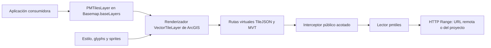

# Investigación de viabilidad

> Investigación previa conservada como referencia. El alcance vigente es la
> prueba mínima descrita en SPECIFICATION.md: HTML/CDN 5.1, un ejemplo fijo y
> un navegador. Las secciones sobre clase reutilizable, npm, compatibilidad y
> alternativas son posibilidades posteriores, no trabajo requerido ahora.

Comprobación documental: 2026-11-09. No se han ejecutado experimentos de renderizado.
«Confirmado» significa respaldado por la fuente indicada; no certifica integración.

## Acceso a documentación

El MCP `mcp-server-for-developer-documentation` respondió correctamente a búsqueda
y lectura de documentación oficial del SDK. Se usó antes de recomendar APIs.
Su endpoint local configurado se conserva en `.codex/config.toml`.
Web se utilizó para Protomaps, el hilo comunitario y fuentes complementarias;
el conector GitHub permitió comprobar el directorio dist y la licencia de FuseSimple.

## Hallazgos

| Tema | Confirmado | Implicación propuesta |
| --- | --- | --- |
| PMTiles | Archivo de teselas consultable por HTTP Range; versión de especificación actual: v3 | Reutilizar lector oficial y evitar descargar el archivo entero |
| VectorTileLayer | Acepta estilo JSON y TileJSON; el soporte TileJSON se documenta desde 4.34 | Investigar entrega de MVT al renderizador ArcGIS |
| Interceptores | `before` puede devolver datos o una promesa y evitar la petición; se utiliza el primer interceptor coincidente | Adaptador con rutas virtuales estrictamente delimitadas |
| BaseTileLayer | Permite sobreescribir fetchTile para devolver imagen/canvas | Vía para investigar ráster después del MVP; no forma parte de la implementación inicial |
| FuseSimple | Superpone MapLibre con ArcGIS transparente; licencia del repositorio MIT | Referencia de experiencia y limitaciones; no proporciona el adaptador nativo que buscamos |
| SDK actual consultado | Las release notes muestran 5.1 | Candidato para spike; resolver versión de paquete antes de instalar |

Fuentes primarias:

- [PMTiles Concepts](https://docs.protomaps.com/pmtiles/).
- [Especificación PMTiles v3](https://github.com/protomaps/PMTiles/blob/main/spec/v3/spec.md).
- [VectorTileLayer](https://developers.arcgis.com/javascript/latest/references/core/layers/VectorTileLayer/).
- [Request types: BeforeInterceptorCallback](https://developers.arcgis.com/javascript/latest/references/core/request/types/).
- [config.request.interceptors](https://developers.arcgis.com/javascript/latest/references/core/config/).
- [BaseTileLayer](https://developers.arcgis.com/javascript/latest/references/core/layers/BaseTileLayer/).
- [Release notes](https://developers.arcgis.com/javascript/latest/release-notes/).

## Lectura de FuseSimple

Su README describe dos motores sincronizados, y el hilo comunitario explica la
misma solución. Esto ayuda a entender el problema, pero no demuestra que el SDK
pueda leer PMTiles directamente. La integración deseada requiere una investigación
propia del transporte de ArcGIS.

Se comprobó `dist/fusesimple.js` en el directorio publicado (1 585 354 bytes,
blob `d02ca01d3db9012639bc659e9a04853aab70aea2`) y se leyó LICENSE (MIT,
MapSimple Contributors, 2026). El conector devolvió contenido vacío al solicitar
el bundle; no se ha auditado su código. La ruta `docs/FuseSimple_v1_Spec.md`
mencionada en el README devolvió 404. No se ha copiado código ni se ha hecho
ingeniería inversa del bundle. No es necesaria para diseñar la prueba propuesta.

Fuentes: [README](https://github.com/MapSimple-Org/FuseSimple-Public),
[LICENSE](https://github.com/MapSimple-Org/FuseSimple-Public/blob/main/LICENSE),
[dist](https://github.com/MapSimple-Org/FuseSimple-Public/tree/main/dist),
[hilo de Esri Community](https://community.esri.com/en/discussion/1623262/introduce-a-pmtilelayer).

## Alternativas

| Ruta | Dependencias y despliegue | Ventajas | Riesgo / decisión |
| --- | --- | --- | --- |
| VectorTileLayer + lector PMTiles + interceptor público | SDK + pmtiles; navegador | Un renderizador; sin servidor adicional; capa del SDK | **Recomendada para spike**, no validada end to end |
| VectorTileLayer + puente Service Worker | SDK + pmtiles + worker propio | Expone respuestas HTTP virtuales sin segundo mapa | Requiere HTTPS/localhost, gestión de scope/control y coexistencia con PWA; alternativa si falla interceptor |
| Endpoint Z/X/Y sobre PMTiles | SDK cliente y servicio adaptador | Contrato HTTP convencional | Requiere infraestructura; cambia el objetivo de lectura directa en navegador |
| FuseSimple / dos motores | Añade MapLibre y sincronización de vistas | Proyecto existente con demos | No es una capa nativa; descartar como dependencia por defecto |
| BaseTileLayer + renderer vectorial externo | SDK + lector + renderer adicional | Evita dos mapas completos | Rasteriza vectores y complica etiquetas; no recomendado para el MVP vectorial |
| Renderer MVT propio | Decodificador, layout, glyphs, sprites, colisiones, GPU | Control completo | Coste y mantenimiento desproporcionados |

La vía Service Worker y la de servidor son alternativas de diseño, no fallbacks
automáticos. Su adopción requeriría revisar requisitos con el usuario si el spike falla.
No sustituir el objetivo vectorial por ráster silenciosamente.

Referencias: [Service Workers](https://developer.mozilla.org/en-US/docs/Web/API/Service_Worker_API/Using_Service_Workers)
y [servidor PMTiles](https://docs.protomaps.com/deploy/server).

## Arquitectura candidata — inferencia por validar

El lector resuelve los bytes; ArcGIS representa las teselas. Que ArcGIS use una
especificación de estilos asociada a MapLibre no implica una dependencia de su
motor. Tampoco garantiza compatibilidad total con todos sus estilos y expresiones.

La prueba debe confirmar el flujo completo, especialmente peticiones desde workers,
tipos de respuesta, expectativas de metadatos y recursos auxiliares. No asumir
que exista un `VectorTileLayer.fetchTile` público equivalente al de BaseTileLayer.

### Clase pública solicitada durante la revisión

El contrato preferido pasa a ser new PMTilesLayer con propiedades familiares del
SDK y carga asíncrona mediante su ciclo de vida. La documentación describe
[patrones de extensión de Accessor](https://developers.arcgis.com/javascript/latest/implementing-accessor/)
y el [ciclo load de VectorTileLayer](https://developers.arcgis.com/javascript/latest/references/core/layers/VectorTileLayer/).
Eso respalda el patrón de uso, pero no demuestra una extensión concreta que
adapte PMTiles. El spike verificará constructores, propiedades y carga mediante
APIs públicas; especialmente url/style heredadas y separación del transporte.
No asumir que los puntos de extensión de BaseTileLayer existen en VectorTileLayer.

## Detalles a resolver con evidencia

- Probar primero `before` con datos JSON y ArrayBuffer, después con un mapa real.
  Un test aislado de esriRequest no verifica el recorrido de VectorTileLayer.
- Seleccionar un prefijo virtual absoluto y único, sin tráfico real hacia él;
  match estricto por instancia y limpieza de registros. Los interceptores amplios
  de la aplicación pueden tener precedencia: detectarlo/documentarlo sin reordenarlos.
- La ausencia de tesela nunca debe resolverse como undefined desde `before`, porque
  permitiría continuar la petición. Determinar una respuesta MVT vacía válida.
- Comprobar min/max zoom, bounds, world wrap, buffers, overscaling y convención 512.
- Comprobar cancelación de lecturas de teselas y limitaciones de cancelación de
  cabeceras/metadatos compartidos; no prometer más de lo que permita el lector.
- El MVP acordado usa un archivo y una fuente MVT por mapa base, con múltiples
  subcapas de estilo permitidas. Rechazar fuentes adicionales o tipos no admitidos
  claramente; no reemplazar fuentes ajenas por coincidencia ni eliminarlas.

## Lector, alojamiento y recursos

La implementación JavaScript oficial expone PMTiles, FetchSource y getZxy;
también ofrece FileSource, que queda fuera del alcance acordado. Su código
distingue compresión y formato; no debemos prometer todos los
algoritmos del contenedor. Se propone empezar por ninguna compresión y gzip,
verificados con la versión elegida. El paquete puede incluir dependencias
transitivas como fflate: «sin MapLibre» no significa «sin dependencias».
[Código del lector](https://github.com/protomaps/PMTiles/blob/main/js/src/index.ts).

El host debe permitir Range y CORS cuando corresponda; ETag y coherencia de
versiones forman parte de las pruebas. Evitar comprimir el archivo PMTiles entero
en el transporte de forma que rompa los offsets. La prueba local necesitará un
servidor de fixtures que implemente Range; no dar por hecho que cualquier servidor
estático cumple ese contrato.
[Alojamiento PMTiles](https://docs.protomaps.com/pmtiles/cloud-storage).

Un archivo MVT no define por sí mismo una cartografía completa. Seleccionar estilo,
glyphs y sprites compatibles y con permisos de uso; atribuir cada fuente.
No confundir metadatos de las subcapas con un estilo listo para producción.

## Builds de Protomaps como dataset de referencia

La [documentación oficial de descargas](https://docs.protomaps.com/basemaps/downloads)
enlaza [maps.protomaps.com/builds](https://maps.protomaps.com/builds/) como canal
de builds diarios v4, compatibles con estilos `@protomaps/basemaps` v4.0.0 o
posteriores. Desaconseja hotlinking, recomienda alojamiento propio y permite
extractos regionales mediante `pmtiles extract`. Exige atribución a OpenStreetMap.
Comprobado el 2026-11-09; el listado dinámico de builds no devolvió texto legible,
por lo que no se ha seleccionado ni descargado un archivo concreto.

Propuesta: utilizar un extracto regional como dataset real de integración,
registrando build, hash, esquema, estilo y licencias. Validar por separado su
compatibilidad con ArcGIS; los builds proporcionan datos, no prueban el renderizado.

## Resultado de investigación

La revisión de requisitos fija SDK 5.1 como mínimo y exige ejemplo CDN además de
npm/ESM. La documentación del spike debe demostrar ambas rutas de consumo sin
duplicar el SDK. Adoptar patrones de los ejemplos oficiales y verificar las firmas
de cada versión, en particular cancelación y gestión del ciclo de vida.
Referencias: [Programming patterns](https://developers.arcgis.com/javascript/latest/programming-patterns/)
y [Async cancellation](https://developers.arcgis.com/javascript/latest/async-cancellation-with-abortcontroller/).

Hay una ruta prometedora sin MapLibre basada en APIs públicas. La viabilidad de
transporte y renderizado aún no está demostrada. El primer entregable técnico,
después de aprobar estos documentos, debe resolver esa incertidumbre antes de
estabilizar la API y ampliar el paquete.
